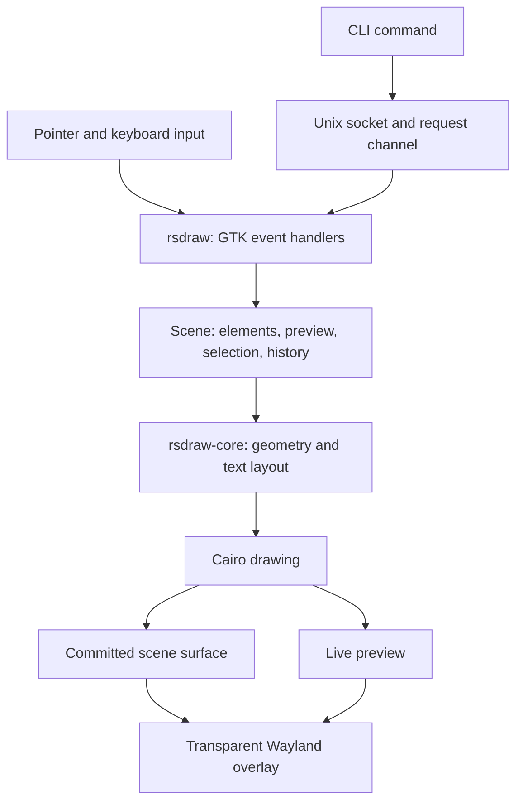

# rsdraw

**rsdraw is a native Rust screen annotation tool for Linux/Wayland.** It places a transparent drawing surface over your desktop so you can sketch diagrams, mark up an application, add notes, or explain something during a presentation or screen share. Annotations live in a separate overlay; the applications underneath continue to run normally.

Draw with freehand strokes, rectangles, diamonds, ellipses, arrows, lines, triangles, and editable text. Select, move, resize, duplicate, or erase elements, undo and redo edits, and pan or zoom the drawing. A keyboard-driven interface keeps the canvas clear: help and color pickers appear only when requested. Toggle desktop passthrough to interact with the applications beneath your annotations while keeping the drawings visible.

The drawing engine follows Excalidraw's shape and text rendering rules through native Rust implementations of its underlying algorithms. Cairo draws the paths, Pango shapes the text, and the bundled Excalifont provides the handwritten lettering. The workspace separates this engine into **`rsdraw-core`** and keeps the GTK/Wayland application in **`rsdraw`**. Neither crate runs JavaScript or embeds a browser.

Requires a Wayland compositor with `wlr-layer-shell` support, such as Hyprland or Sway. Drawings and undo history stay in memory for the running session; saving/loading scenes and Excalidraw file import/export are not implemented. See [how it works](#how-it-works) for the architecture and rendering pipeline.

## Build and run

System dependencies: GTK4 4.12+, gtk4-layer-shell, Cairo, Pango/PangoCairo, Fontconfig, and a Rust toolchain. The bundled font does not need to be installed system-wide.

```bash
cargo build --release -j 5
./target/release/rsdraw
```

Builds and verification should use at most five cores. `-j 5` caps Cargo jobs; on Linux, `taskset -c 0-4 cargo build --release -j 5` also limits compiler/linker threads to five logical CPUs (choose five permitted CPUs if your CPU affinity differs).

## Drawing

| Default shortcut | Tool |
| --- | --- |
| `P` or `7` | Freehand |
| `R` or `2` | Rectangle |
| `D` or `3` | Diamond |
| `O` or `4` | Ellipse |
| `A` or `5` | Arrow with an open head |
| `L` or `6` | Line |
| `T` or `8` | Text |
| `Shift+T` | Triangle (rsdraw extension) |
| `V` or `1` | Selection |
| `E` or `0` | Eraser |

Letters mean an unmodified key, not Shift+letter. Start drawing immediately with the freehand tool. Pick a shape shortcut and drag to draw it; tools stay active by default. Hold Shift for a square/circle or angle-constrained line; hold Alt to draw a shape from its center. Click with the text tool and type. Enter inserts a newline; Escape or Ctrl+Enter finishes. Double-click text to edit it.

`Ctrl+Z` undoes, `Ctrl+Shift+Z` / `Ctrl+Y` redoes, and `Ctrl+Delete` clears (undoable). `?` / `F1` opens help generated from your actual config. `S` opens the stroke color palette; `G` opens the fill color picker. `Ctrl+Q` exits. See [all controls](docs/CONTROLS.md).

`theme = "dark"` applies Excalidraw's dark-mode color transform, making default ink visible on dark desktops while retaining a transparent canvas. Set `theme = "light"` for light desktops. Shapes, text, and color swatches use the same transform; the setting does not paint a background.

## Local configuration

On first run, rsdraw creates `$XDG_CONFIG_HOME/rsdraw/config.toml`, or `~/.config/rsdraw/config.toml` if XDG_CONFIG_HOME is unset. [config/default.toml](config/default.toml) is the complete editable default and the source used by the program.

```bash
rsdraw config-path
rsdraw check-config
rsdraw --config ./config/default.toml
# Alternatively: RSDRAW_CONFIG=/path/to/config.toml rsdraw
```

Configure shortcuts, stroke/fill color, width, roughness, and font there. Strings and lists of alternate bindings are supported; `[]` disables an action. Restart the daemon after editing. Existing local settings are preserved; see [configuration and upgrading](docs/CONFIGURATION.md) for older configs that use `F/C/X` tools or numeric color shortcuts.

## Commands

Run these from another terminal or compositor binding while the daemon is running:

```bash
rsdraw toggle                 # Drawing / desktop passthrough; drawings stay visible
rsdraw clear                  # Clear drawings (undoable)
rsdraw undo
rsdraw redo
rsdraw tool rectangle         # Also diamond, ellipse, triangle, arrow, line, freehand, text
rsdraw font Excalifont        # Multiword family names are supported
rsdraw font-size 24           # Independent of stroke width
rsdraw color '#e03131'        # Names or #RGB / #RGBA / #RRGGBB / #RRGGBBAA
rsdraw fill transparent
rsdraw width 2
rsdraw roughness 1            # 0 clean; 1 hand-drawn; 2 very rough (range 0–3)
rsdraw fill-style hachure     # hachure / cross_hatch / solid
rsdraw stroke-style solid    # solid / dashed / dotted
rsdraw theme dark            # dark / light: match the desktop behind the overlay
rsdraw roundness round       # round / sharp (round is the reference default)
rsdraw stroke-variability constant # constant / variable
rsdraw picker                # On-demand color picker
rsdraw help                  # Configured shortcuts and commands
rsdraw quit
```

Invalid commands or values report an error and leave the drawing settings unchanged. `--config` affects startup, help, and validation; IPC commands address the single running daemon.

## Hyprland bindings

```ini
bind = $mainMod, D, exec, rsdraw toggle
bind = $mainMod SHIFT, D, exec, rsdraw clear
bind = $mainMod SHIFT, Z, exec, rsdraw undo
```

The compositor handles global shortcuts while rsdraw passes input through. rsdraw's own shortcuts apply when the overlay has keyboard focus.

## How it works

### 1. Two crates with separate responsibilities

| Crate | Responsibility | Main modules |
| --- | --- | --- |
| [`rsdraw`](Cargo.toml) | Runs the desktop overlay, receives input, manages scene edits and history, loads configuration, and handles commands from other processes. | [`app.rs`](src/app.rs), [`model.rs`](src/model.rs), [`config.rs`](src/config.rs), [`keys.rs`](src/keys.rs), [`ipc.rs`](src/ipc.rs) |
| [`rsdraw-core`](crates/rsdraw-core/Cargo.toml) | Represents drawable elements, generates deterministic paths, lays out text, and paints into a Cairo context. It also provides bounds, hit testing, fonts, and color conversion. | [`canvas.rs`](crates/rsdraw-core/src/canvas.rs), [`rendering.rs`](crates/rsdraw-core/src/rendering.rs), [`rough.rs`](crates/rsdraw-core/src/rough.rs), [`text.rs`](crates/rsdraw-core/src/text.rs) |

The main crate decides **what changes in the scene and when to redraw**. The core decides **how each element is drawn**. The core depends on Cairo, Pango, and Fontconfig, but has no GTK or Wayland dependency. It can render to an image surface without opening a desktop window, as demonstrated by the gallery and benchmark examples.



### 2. Startup and the desktop overlay

Starting `rsdraw` without a command loads and validates the TOML configuration, registers the bundled fonts, and creates a GTK application. Its undecorated window uses layer-shell's overlay layer and anchors to all four screen edges. Transparent styles on the window and canvas, together with a cleared alpha channel, leave the desktop visible wherever nothing has been drawn.

The application begins in drawing mode. When `rsdraw toggle` switches to passthrough, it finishes active text editing, cancels an unfinished drag, gives the window an empty pointer-input region, and disables its keyboard interaction. The compositor can then deliver input to the desktop underneath. The window and its annotations remain visible. Toggling again restores drawing input.

### 3. Input becomes an editable scene

[`Scene`](src/model.rs) holds the committed elements, current tool and style, selected elements, unfinished preview, text being edited, pan/zoom, and undo/redo stacks. Each drawable element stores its own geometry, style, and seed. Geometry is either a shape with start/end points, a sequence of freehand points, or text with a position.

Pointer positions arrive in screen coordinates and are converted into scene coordinates:

```text
scene position = (screen position - pan offset) / zoom
screen position = scene position * zoom + pan offset
```

This keeps element positions independent of the current view. A shape drag creates a temporary preview; movement updates its endpoints and applies Shift/Alt constraints. Freehand movement appends samples when the pointer has moved at least half a screen pixel. Releasing the pointer commits the completed element and records an undoable edit. Cancelling discards the preview or restores the state from before a move, resize, or eraser drag.

Selection uses bounds and geometry hit tests, with tolerance adjusted for zoom. Clicking overlapping elements selects the topmost hit. A marquee selects enclosed elements, while dragging a selection moves it or resizes it from its handle. The eraser removes whole elements it intersects and checks intermediate positions during fast motion to reduce skipped hits.

### 4. Shapes become deterministic drawing paths

For rectangles, diamonds, ellipses, lines, arrows, and triangles, the core converts geometry and style into a typed rendering request. [`rough.rs`](crates/rsdraw-core/src/rough.rs) implements the relevant RoughJS 4.6.4 algorithms in Rust, using Excalidraw's rules for roughness, rounded corners, dashes, fills, and arrowheads.

A stored seed drives the small variations that give strokes their hand-drawn appearance. Preserving the seed and the order of random-number consumption makes repeated rendering stable: an unchanged shape does not acquire a different sketch on each frame. Small shapes use the reference's reduced roughness; dashed and dotted outlines use its stroke-width adjustments and single-stroke behavior.

The output is a collection of move, line, and cubic Bézier operations, grouped into outlines, solid fills, or sketch fills. Hachure and cross-hatch fills are generated by scanning the shape into fill lines. Arrowheads are derived from the generated line geometry. Cairo replays these operations with the appropriate widths, dash arrays, fill rules, and round caps/joins.

### 5. Freehand strokes become filled outlines

Freehand uses a separate pipeline because a pen stroke is represented as a filled outline around the sampled path:

| Mode | Native implementation | Behavior |
| --- | --- | --- |
| `constant` | [`freehand.rs`](crates/rsdraw-core/src/freehand.rs), adapted from Excalidraw's laser-pointer geometry | Smooths the sampled path and constructs a constant-width outline with rounded ends and corner handling. |
| `variable` | [`variable_freehand.rs`](crates/rsdraw-core/src/variable_freehand.rs), adapted from perfect-freehand 1.2.0 | Simulates pressure from movement to vary stroke thickness, with the reference's smoothing, easing, and cap rules. |

The outline is converted directly into Cairo path operations. The core preserves Excalidraw's coordinate truncation and converts quadratic curves into equivalent cubic curves, avoiding SVG generation and parsing during pointer updates. Non-finite input or outline coordinates are rejected before reaching Cairo.

### 6. Text editing and rendering

While text is being edited, a GTK `TextView` handles the caret, selection, clipboard, Unicode, and input methods. The scene tracks the edited string, and the committed copy is temporarily excluded from the cached drawing so it is not painted behind the editor. Finishing the edit returns the text to the normal scene-rendering path.

For committed text, [`text.rs`](crates/rsdraw-core/src/text.rs) normalizes line endings, expands tabs to eight spaces, preserves blank lines, and asks Pango to shape the glyphs using fractional advances. The core measures the widest line and calculates the total line-box height from the font size and family-specific line height.

Each line is drawn separately at Excalidraw's alphabetic baseline, calculated from font ascent, descent, units per em, and line height. Excalifont uses a line height of `1.25 × font size`; at 20 px, that gives 25 px between baselines. This explicit placement prevents a fallback font on one line from shifting subsequent lines.

The bundled Excalifont subsets are written to the user's cache directory and registered with Fontconfig for this process. They do not need a system-wide installation. Other configured font families rely on fonts available on the system.

### 7. Redrawing, caching, and colors

There are two levels of caching:

- **Element paths:** the core reuses generated geometry while the element's geometry, seed, and path-affecting style stay the same. History clones share these cached paths. Changing ink color or theme can reuse the geometry; changing width, roughness, or fill structure requires regeneration.
- **Committed scene surface:** the application paints committed elements into a Cairo image surface. It rebuilds that surface when the elements, edited-text index, pan, zoom, window size, or display scale change. An unchanged surface can be painted again without drawing every element individually.

The live preview, selection outline, resize handle, and selection marquee are drawn above the cached scene. During an ordinary drawing drag, this lets the app update the preview without repainting all committed elements. GTK coalesces queued redraw requests.

Colors are applied when paths or text are painted. Dark mode uses the reference's `invert(93%) hue-rotate(180deg)` color transform while retaining alpha. Theme changes also update existing elements and history snapshots so undo does not unexpectedly bring back the previous theme.

### 8. Undo, configuration, and external commands

Scene history stores snapshots of committed elements, with up to 100 undo entries. Completed drawing, moving, resizing, erasing, styling, and clearing operations are recorded as edits. An entire eraser drag is one undo step. Undo/redo restores element state, and making a new edit clears the redo stack. The scene and its history are discarded when the process exits.

Configuration supplies startup defaults and keyboard bindings. Each element keeps its own style; changing drawing defaults does not restyle unselected existing elements. Style actions also apply to the current selection or text being edited. Bindings are validated for errors and conflicts, and the help view is generated from the loaded configuration.

Commands such as `rsdraw toggle` and `rsdraw color '#e03131'` start a short-lived client that sends a request over a local Unix socket. The socket lives at `$XDG_RUNTIME_DIR/rsdraw.sock`, with `/tmp/rsdraw-<uid>/rsdraw.sock` as the fallback. A listener thread forwards requests through a channel; the GTK main loop handles them and sends back a success or error response. This lets compositor shortcuts control the running application even while its window is passing input through.

### 9. Excalidraw compatibility and verification

The local `excalidraw/` clone is a read-only reference for rendering behavior. Development scripts extract its actual functions to generate independent fixtures; the application uses the native Rust implementations at runtime. JavaScript bundles remain only as development oracles, and normal builds do not require Node, a browser, or the clone.

The checked-in reference suite contains 314 geometry cases and 40 browser text cases. Shape tests compare path operations and rendered options; freehand tests compare outline points and pixels produced by replaying reference paths through Cairo. Text tests compare browser-measured widths, line-box heights, and baselines. Separate Wayland smoke tests cover native editing and transparent rendering.

Compatibility covers rsdraw's supported tools. Triangle is an rsdraw extension; bound labels, elbow arrows, images, frames, and Excalidraw scene-file interoperability are not implemented. Cairo/Pango antialiasing and fallback fonts can differ from browser rendering, even when the tested geometry and text metrics match.

## Development

See [development and validation](docs/DEVELOPMENT.md) for the source layout, test commands, fixture regeneration, and rendering benchmarks, and [third-party notices](THIRD_PARTY_NOTICES.md) for the algorithms and fonts used by the project.
